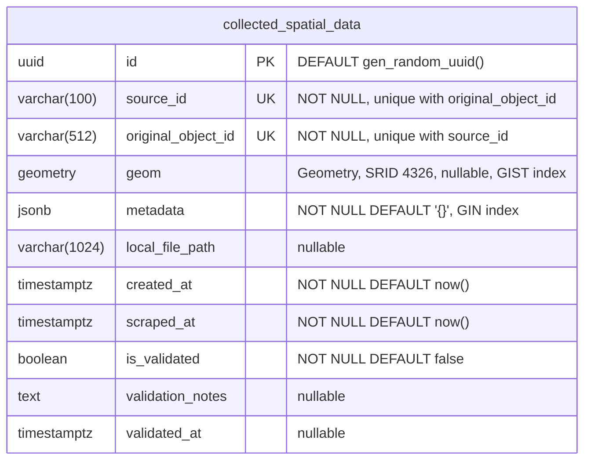

# Add PostGIS schema for collected spatial data (`init_db.sql`)

## Summary

Adds `init_db.sql`, which creates the PostGIS extension and one universal table, `collected_spatial_data`, used by every collector in `specs/` (cadastre, DREAM, Earthdata, EcoZagroza, OSM/Overpass).

## Approach: hybrid storage

The sources differ a lot in attributes and geometry, so the schema splits each record into a fixed relational part and a flexible part:

- **Relational columns** hold what every source has: who produced the record (`source_id`, `original_object_id`), when it was collected (`created_at`, `scraped_at`), and the manual review state (`is_validated`, `validation_notes`, `validated_at`).
- **PostGIS `geom`** (`GEOMETRY(Geometry, 4326)`) holds points, lines, polygons and multipolygons in one column, all in WGS84. Collectors reproject before insert (for example, cadastre vector tiles come in EPSG:3857). `geom` is nullable because most DREAM records have no coordinates and are located only by KATOTTG code or address.
- **JSONB `metadata`** holds the source's own attributes as received: OSM tags, OCDS fields, CMR granule links, sensor values. A new source or a changed source format needs no migration. A check constraint keeps it a JSON object.
- **`local_file_path`** points to large files (rasters, granules, documents) kept on disk instead of in the database.

## Indexes and constraints

| Object | Type | Purpose |
|---|---|---|
| `collected_spatial_data_pkey` | B-tree on `id` (UUID, `gen_random_uuid()`) | Primary key |
| `uq_collected_source_object` | Unique on (`source_id`, `original_object_id`) | Lets collectors upsert with `ON CONFLICT` and prevents duplicates |
| `idx_collected_geom` | GIST on `geom` | Spatial queries (`ST_Intersects`, `ST_DWithin`, bbox filters) |
| `idx_collected_metadata` | GIN on `metadata` | Attribute containment queries (`metadata @> '{"tags":{"landuse":"landfill"}}'`) |
| `chk_collected_metadata_object` | Check | `metadata` must be a JSON object |

`original_object_id` must be unique within a source, so it includes the object type where raw IDs repeat: `way/123`, `kadastr/<cadnum>`, `objects/<internal.id>`.

## ER diagram

## Testing

- Applied `init_db.sql` twice to a `postgis/postgis:16-3.4` container; the second run is a no-op (`IF NOT EXISTS`).
- Inserted an OSM polygon and a DREAM record with `geom = NULL`; a `metadata @>` query returned the expected row.

## Requirements

PostgreSQL 13+ (built-in `gen_random_uuid()`) with PostGIS installed.
